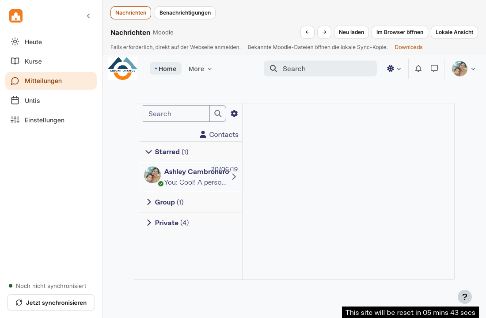

# Hybrid: Prüfung gegen einen echten Moodle-Demoserver

Getestet am 14. November 2026 mit dem nativen Linux-Build der App und
[Mount Orange](https://school.moodledemo.net/), Moodle **5.3.1
(Build: 20261112)**. Verwendet wurde das auf der Loginseite veröffentlichte
Studentenkonto. Die folgenden Bilder zeigen den echten Server in der App.
Es wurden keine Nachrichten gesendet und keine Kursinhalte auf dem Server geändert.

## Ergebnisse

| Prüfung | Ergebnis |
| --- | --- |
| API-Anmeldung aus der App | Erfolgreich; 19 eingeschriebene Kurse abgerufen |
| Moodle-Autologin in der nativen Webansicht | Beim ersten Durchlauf erfolgreich; IP-Sonderfall nach Neustart siehe unten |
| Original-Kursseite | „Digital Literacy“, Kurs 66, dargestellt und bedienbar |
| Echter Ressourcenlink | Modul 781 öffnet `DigitalLiteraciesTranscript.pdf` über den bestehenden Dateikern |
| Fehlende lokale Kopie | PDF mit 117.705 Byte heruntergeladen; PDF-Dateikopf geprüft und lokaler Öffnungspfad erfasst |
| Lokal geänderte Kopie | Teständerung an der lokalen PDF angebracht; erneuter Linkaufruf öffnet denselben Pfad und lässt den SHA-256 unverändert |
| Direkte Browser-Datei-URL | Die echte `pluginfile.php`-URL öffnet ebenfalls dieselbe geänderte lokale Kopie |
| Dateistatus | Backend meldet `modifiedLocally: true` |
| Nachrichten und Benachrichtigungen | Originalseiten mit angemeldeter Sitzung geladen |
| Lokale Rückfallansicht | Echter Moodle-Kurs aus dem Cache angezeigt |
| Sidebar und lokale Einstellungen | Mit echten Mausereignissen bedienbar, auch nach Verlassen der Webansicht |
| Größenwechsel | Sidebar eingeklappt und wieder ausgeklappt; echte Moodle-Seite passt sich an die verfügbare Breite an |

Das Öffnen mit einem Standardprogramm wurde durch einen Testaufruf von
`xdg-open` geprüft, der den übergebenen lokalen Pfad protokolliert. Ein externer
PDF-Betrachter wurde dabei nicht gestartet.

## Beim echten Test gefundener und behobener Fehler

Der vorherige GTK-Container konnte die natürliche Breite der bereits geladenen
Webseite beibehalten. Beim Ausklappen der App-Sidebar wurde Moodle deshalb rechts
abgeschnitten. Die Linux-Webansicht verwendet jetzt einen `GtkLayout`-Container
mit expliziter Zuweisung der tatsächlichen Viewportgröße. Der Größenwechsel wurde
anschließend erneut mit dem angemeldeten echten Kurs geprüft. Die Originalseite
selbst erhält keine CSS-Änderungen.

## IP-Sonderfall beim Autologin

Nach einem App-Neustart meldete Moodle einmal **„Client IP address mismatch“**.
Die Testumgebung verwendet einen ausgehenden Proxy; unterschiedliche öffentliche
IP-Adressen für den Rust-Client und die Browseranfrage sind eine mögliche Ursache.
Die genaue Netzursache wurde nicht nachgewiesen. Die normale manuelle Anmeldung
auf der Originalseite war anschließend erfolgreich. Mit dieser Sitzung wurden
der korrigierte Kurs, die Dateilinks und die Mitteilungsseite erneut geprüft.

Ein wiederholt zuverlässiger Autologin nach Neustarts ist für diese
Proxy-Umgebung damit **nicht nachgewiesen**. Dieser Fall sollte zusätzlich in
einer Umgebung mit stabiler ausgehender IP geprüft werden. Es wurden keine
Moodle-Sicherheitsprüfungen oder TLS-Prüfungen abgeschaltet.

## Automatisierte Prüfungen

- Nativer Linux-Build, rustfmt und Clippy erfolgreich.
- Nach der GTK-Korrektur: 90 Workspace-Tests bestanden; zwei bestehende Tests
  für externe Dienste standardmäßig ignoriert.
- Der explizit gestartete Live-Test gegen den Demoserver hat zusätzlich bestanden:

  ```sh
  MOODLE_URL=https://school.moodledemo.net \
  MOODLE_USER=student MOODLE_PASSWORD='<aktuelles veröffentlichtes Demo-Passwort>' \
  cargo test -p tsa-moodle --test session live --locked -- --ignored
  ```

- Für den vorangegangenen Code-Stand `47ea7c4` ist auch die
  [GitHub-CI](https://github.com/ds23238/Tuo-School-App/actions/runs/43643072445)
  einschließlich Frontend sowie Rust unter Windows und Linux erfolgreich.

## Screenshots

Echte Kursseite nach dem Größenwechsel:


Echte Moodle-Mitteilungsseite:



## Anleitung für den späteren Praxistest

Diese Checkliste ist ein noch auszuführender Testplan. Sie ergänzt die oben
protokollierten Ergebnisse und gilt nicht bereits als bestanden.

### Vorbereitung

- [ ] Aktuellen Stand des Branches `hybrid` auschecken oder einen daraus gebauten
  Installer verwenden. Den getesteten Commit mit `git rev-parse HEAD` bzw. die
  genaue Herkunft des Installers notieren.
- [ ] App gemäß [Entwicklungsanleitung](../README.md#entwicklung) starten oder
  installieren. Betriebssystem und Version notieren.
- [ ] Zunächst in einem unveränderten Netzwerk mit möglichst stabiler
  ausgehender IP testen. VPN und Proxy einschließlich ihres Zustands notieren;
  während dieses ersten Durchlaufs nicht umschalten.
- [ ] Einen beschreibbaren Testordner als Sync-Ordner wählen.
- [ ] Auf [Mount Orange](https://school.moodledemo.net/login/index.php) die
  **aktuell veröffentlichten** Zugangsdaten für das Studentenkonto nachsehen.
  Das Demo-Passwort und die verfügbaren Kurse können sich ändern.
- [ ] Den angekündigten Demo-Reset beachten. Fällt ein Fehler zeitlich mit dem
  Reset zusammen, den Durchlauf nach dem Reset mit frischer Anmeldung wiederholen.

### 1. Erstmalige Anmeldung

1. Das Moodle-Demokonto in der App verbinden. Falls dort bereits ein Konto
   eingerichtet ist, einen Kontowechsel nur mit Absicht durchführen; alternativ
   ein separates Betriebssystem-Testkonto verwenden.
2. Einen Kurs mit einer herunterladbaren Datei öffnen, beispielsweise
   „Digital Literacy“, sofern dieser weiterhin verfügbar ist.
3. Prüfen, ob die Originalseite bereits angemeldet erscheint, ohne dort erneut
   Benutzername und Passwort einzugeben. Den sichtbaren Kontonamen kontrollieren.
4. Nachrichten und Benachrichtigungen öffnen und wieder zum Kurs wechseln.
   Dabei keine Nachrichten versenden oder Kursinhalte bearbeiten.

**Erwartet:** Die API-Anmeldung funktioniert, die Originalseiten laden und die
Web-Sitzung bleibt beim Wechsel zwischen Ansichten erhalten. Eine zusätzliche
Web-Anmeldung oder eine Fehlermeldung wird gesondert protokolliert.

### 2. Vollständiges Beenden und erneuter Autologin

Während dieser Prüfung das Moodle-Konto in der App **nicht entfernen** und
Browserdaten nicht löschen. Das wäre ein eigener Logout-Test.

1. Die App über **„Beenden“ im Tray-Menü** vollständig schließen. Das Schließen
   des Fensters allein kann die App nur im Tray verstecken. Ohne Tray prüfen,
   dass das App-Fenster geschlossen und der App-Prozess beendet ist.
2. Neu starten und denselben Kurs öffnen, ohne vorher eine manuelle Anmeldung
   auf der Originalseite vorzunehmen.
3. Festhalten, ob die Kursseite angemeldet geladen wird oder eine Loginseite
   beziehungsweise Fehlermeldung erscheint.
4. Insgesamt **drei Neustartdurchläufe** durchführen. Vor einem davon die App
   etwa **zehn Minuten beendet lassen**. Netzwerk, VPN und Proxy unverändert lassen.

| Durchlauf | Pause vor Neustart | Kurs automatisch angemeldet? | Meldung / zusätzliche Anmeldung |
| --- | --- | --- | --- |
| 1 | Kurz | Noch nicht geprüft | |
| 2 | Kurz | Noch nicht geprüft | |
| 3 | Etwa 10 Minuten | Noch nicht geprüft | |

**Erwartet:** Der Kurs ist in allen drei Durchläufen ohne zusätzliche
Web-Anmeldung erreichbar. Das prüft das Ergebnis für die Nutzung; ob dabei eine
vorhandene Sitzung weiterverwendet oder ein neuer Autologin-Schlüssel verwendet
wurde, lässt sich aus der Oberfläche allein nicht sicher unterscheiden.

Falls eine Anmeldung oder ein IP-Fehler erscheint, zunächst den unveränderten
Zustand dokumentieren. Erst danach die normale manuelle Anmeldung auf der
Originalseite versuchen und deren Ergebnis separat notieren. Ein erfolgreicher
manueller Login zählt als funktionierender Rückfall, nicht als bestandener
Autologin-Durchlauf.

### 3. Moodle-Dateien und lokale Änderungen

1. In der Original-Kursseite einen Dateilink öffnen. Prüfen, dass eine fehlende
   Kopie im gewählten Sync-Ordner landet und mit einem passenden lokalen
   Standardprogramm geöffnet wird. Den vollständigen lokalen Pfad notieren.
2. Dieselbe Datei erneut über Moodle öffnen. Es muss derselbe lokale Pfad
   verwendet werden, ohne eine zusätzliche Download-Kopie anzulegen.
3. Eine **entbehrliche lokale Testkopie** bearbeiten, etwa eine Anmerkung in
   einer PDF speichern. Die bearbeitete Datei schließen und ihren SHA-256
   notieren. Keine Datei auf den Moodle-Server hochladen.
4. Den ursprünglichen Moodle-Dateilink erneut öffnen. Pfad, sichtbare Änderung
   und SHA-256 müssen unverändert bleiben.
5. Falls verfügbar, auch einen Link testen, der ein neues Fenster öffnet, sowie
   eine direkte Moodle-Datei-URL. Niemals URLs mit Tokens oder Autologin-Schlüsseln
   in den Testbericht kopieren.
6. Zur lokalen Kursansicht wechseln und den Dateistatus kontrollieren. Eine
   lokal veränderte Kopie muss als solche erkannt werden. Während dieses Tests
   keine ausdrückliche Aktion zum Übernehmen einer neuen Online-Version auslösen.

SHA-256 beispielsweise mit PowerShell unter Windows:

```powershell
Get-FileHash -Algorithm SHA256 -LiteralPath 'C:\Pfad\zur\Testdatei.pdf'
```

Oder unter Linux:

```sh
sha256sum '/pfad/zur/testdatei.pdf'
```

**Erwartet:** Bekannte Dateien öffnen lokal; ein erneuter Linkaufruf überschreibt
keine lokale Änderung. Nicht zuordenbare Dateien dürfen als normale Downloads
im getrennten Download-Ordner landen und müssen als solcher Fall notiert werden.

### 4. Darstellung und Bedienung

- [ ] Mit geladener echter Moodle-Seite die App-Sidebar mehrfach ein- und
  ausklappen. Inhalte passen sich an; die rechte Seite wird nicht abgeschnitten.
- [ ] Das Fenster verkleinern, vergrößern und maximieren. Die Webseite bleibt
  innerhalb des Inhaltsbereichs; Sidebar und Bedienleiste bleiben erreichbar.
- [ ] Mit **echten Mausklicks** Sidebar, Zurück/Vorwärts und lokale Ansicht
  bedienen. Nach dem Wechsel zu den Einstellungen ein Formularfeld verwenden.
  Es darf keine unsichtbare Browserfläche Eingaben abfangen.
- [ ] Zum eigenen Stundenplan und zurück wechseln. Die lokale Navigation bleibt
  bedienbar, während die Originalseiten innerhalb ihres Bereichs navigieren.

### 5. Separater Netzwerkwechsel-Test

Erst nach dem unveränderten Netzwerkdurchlauf optional einen Netzwerk- oder
VPN-Wechsel testen. Zeitpunkt und Änderung genau notieren. Ein dabei auftretender
IP-Fehler wird getrennt von den drei Neustartdurchläufen bewertet. Anschließend
prüfen, ob die normale manuelle Web-Anmeldung wieder funktioniert.

### Ergebnisprotokoll und offene Punkte

Für jeden Fehler festhalten:

- Datum/Uhrzeit, getesteter Commit bzw. Installer und Betriebssystem.
- Moodle-Instanz, verwendete Kontorolle und betroffener Kurs/Dateiname.
- Exakte Schritte, erwartetes Ergebnis und tatsächlich beobachtetes Ergebnis.
- Ob der App-Prozess zuvor vollständig beendet war und wie lange.
- Netzwerktyp, VPN-/Proxy-Zustand und etwaige Änderungen; keine öffentliche
  IP-Adresse veröffentlichen, sofern sie für die Diagnose nicht benötigt wird.
- Screenshot und exakter Fehlertext. Passwörter, Tokens, Autologin-Schlüssel und
  vertrauliche Inhalte aus Screenshots und Logs entfernen.
- Bei Dateien: gleicher oder anderer lokaler Pfad sowie SHA-256 vor und nach
  dem erneuten Öffnen.

Die Ergebnisse im PR ergänzen und bestandene Punkte mit Testdatum kennzeichnen.
Ungeprüfte Punkte offen lassen. Dieser Moodle-Test ersetzt weder einen Live-Test
gegen WebUntis noch einen interaktiven Test auf einem anderen Betriebssystem.
Die Zusammenführung des PR erfolgt erst nach ausdrücklicher Freigabe.

## Noch offen

- Wiederholter Autologin nach Neustarts mit stabiler ausgehender IP.
- Interaktiver Test der Windows-WebView; die Windows-CI ist kein Ersatz dafür.
- Live-Test gegen WebUntis und gegebenenfalls schulabhängige SSO-/MFA-Verfahren.

PR #9 bleibt bis zur weiteren Prüfung und Freigabe als Entwurf offen.
