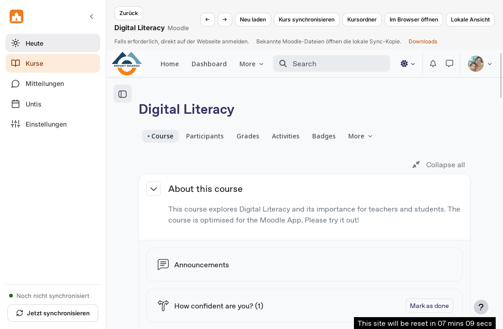

# Hybrid: Prüfung gegen einen echten Moodle-Demoserver

Getestet am 14. November 2026 mit dem nativen Linux-Build der App und
[Mount Orange](https://school.moodledemo.net/), Moodle **5.3.1
(Build: 20261112)**. Verwendet wurde das auf der Loginseite veröffentlichte
Studentenkonto. Die folgenden Bilder zeigen den echten Server in der App.
Es wurden keine Nachrichten gesendet und keine Kursinhalte auf dem Server geändert.

## Ergebnisse

| Prüfung | Ergebnis |
| --- | --- |
| API-Anmeldung aus der App | Erfolgreich; 19 eingeschriebene Kurse abgerufen |
| Moodle-Autologin in der nativen Webansicht | Beim ersten Durchlauf erfolgreich; IP-Sonderfall nach Neustart siehe unten |
| Original-Kursseite | „Digital Literacy“, Kurs 66, dargestellt und bedienbar |
| Echter Ressourcenlink | Modul 781 öffnet `DigitalLiteraciesTranscript.pdf` über den bestehenden Dateikern |
| Fehlende lokale Kopie | PDF mit 117.705 Byte heruntergeladen; PDF-Dateikopf geprüft und lokaler Öffnungspfad erfasst |
| Lokal geänderte Kopie | Teständerung an der lokalen PDF angebracht; erneuter Linkaufruf öffnet denselben Pfad und lässt den SHA-256 unverändert |
| Direkte Browser-Datei-URL | Die echte `pluginfile.php`-URL öffnet ebenfalls dieselbe geänderte lokale Kopie |
| Dateistatus | Backend meldet `modifiedLocally: true` |
| Nachrichten und Benachrichtigungen | Originalseiten mit angemeldeter Sitzung geladen |
| Lokale Rückfallansicht | Echter Moodle-Kurs aus dem Cache angezeigt |
| Sidebar und lokale Einstellungen | Mit echten Mausereignissen bedienbar, auch nach Verlassen der Webansicht |
| Größenwechsel | Sidebar eingeklappt und wieder ausgeklappt; echte Moodle-Seite passt sich an die verfügbare Breite an |

Das Öffnen mit einem Standardprogramm wurde durch einen Testaufruf von
`xdg-open` geprüft, der den übergebenen lokalen Pfad protokolliert. Ein externer
PDF-Betrachter wurde dabei nicht gestartet.

## Beim echten Test gefundener und behobener Fehler

Der vorherige GTK-Container konnte die natürliche Breite der bereits geladenen
Webseite beibehalten. Beim Ausklappen der App-Sidebar wurde Moodle deshalb rechts
abgeschnitten. Die Linux-Webansicht verwendet jetzt einen `GtkLayout`-Container
mit expliziter Zuweisung der tatsächlichen Viewportgröße. Der Größenwechsel wurde
anschließend erneut mit dem angemeldeten echten Kurs geprüft. Die Originalseite
selbst erhält keine CSS-Änderungen.

## IP-Sonderfall beim Autologin

Nach einem App-Neustart meldete Moodle einmal **„Client IP address mismatch“**.
Die Testumgebung verwendet einen ausgehenden Proxy; unterschiedliche öffentliche
IP-Adressen für den Rust-Client und die Browseranfrage sind eine mögliche Ursache.
Die genaue Netzursache wurde nicht nachgewiesen. Die normale manuelle Anmeldung
auf der Originalseite war anschließend erfolgreich. Mit dieser Sitzung wurden
der korrigierte Kurs, die Dateilinks und die Mitteilungsseite erneut geprüft.

Ein wiederholt zuverlässiger Autologin nach Neustarts ist für diese
Proxy-Umgebung damit **nicht nachgewiesen**. Dieser Fall sollte zusätzlich in
einer Umgebung mit stabiler ausgehender IP geprüft werden. Es wurden keine
Moodle-Sicherheitsprüfungen oder TLS-Prüfungen abgeschaltet.

## Automatisierte Prüfungen

- Nativer Linux-Build, rustfmt und Clippy erfolgreich.
- Nach der GTK-Korrektur: 90 Workspace-Tests bestanden; zwei bestehende Tests
  für externe Dienste standardmäßig ignoriert.
- Der explizit gestartete Live-Test gegen den Demoserver hat zusätzlich bestanden:

  ```sh
  MOODLE_URL=https://school.moodledemo.net \
  MOODLE_USER=student MOODLE_PASSWORD='<aktuelles veröffentlichtes Demo-Passwort>' \
  cargo test -p tsa-moodle --test session live --locked -- --ignored
  ```

- Für den vorangegangenen Code-Stand `47ea7c4` ist auch die
  [GitHub-CI](https://github.com/ds23238/Tuo-School-App/actions/runs/43643072445)
  einschließlich Frontend sowie Rust unter Windows und Linux erfolgreich.

## Screenshots

Echte Kursseite nach dem Größenwechsel:



Echte Moodle-Mitteilungsseite:


## Noch offen

- Wiederholter Autologin nach Neustarts mit stabiler ausgehender IP.
- Interaktiver Test der Windows-WebView; die Windows-CI ist kein Ersatz dafür.
- Live-Test gegen WebUntis und gegebenenfalls schulabhängige SSO-/MFA-Verfahren.

PR #9 bleibt bis zur weiteren Prüfung und Freigabe als Entwurf offen.
